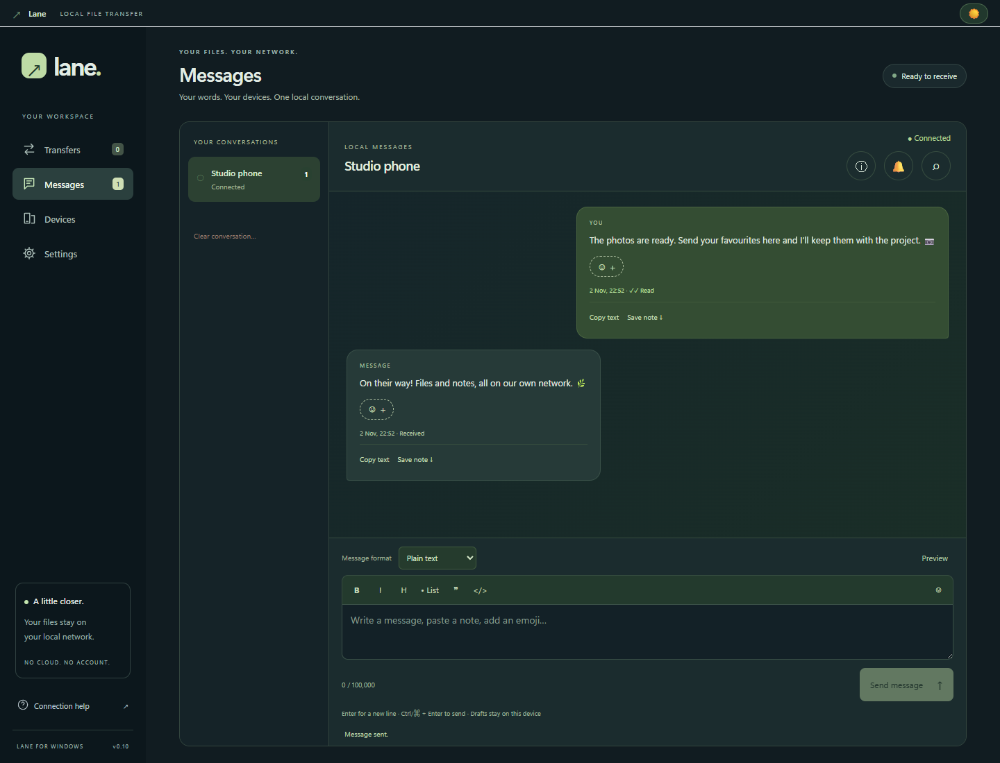
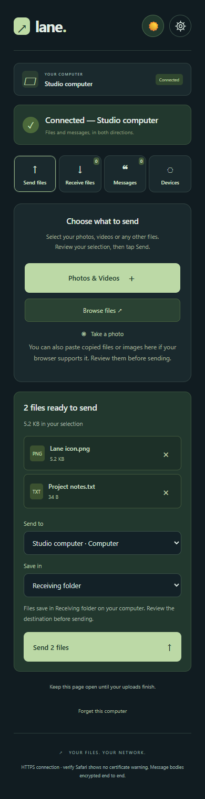
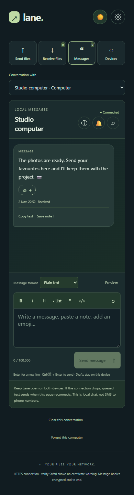

# Lane

Coded by Max Jensen.

A Windows app and mobile browser interface for local files and messages in both directions. All interface text is English. No account, cloud storage, telemetry, CDN or external transfer service is used at runtime.

Source: [R3verse/lane](https://github.com/R3verse/lane). Download binaries are kept locally and are not committed to this repository.

## A look inside Lane



<table>
  <tr>
    <th>Review files before sending</th>
    <th>Keep the conversation close</th>
  </tr>
  <tr>
    <td valign="top"></td>
    <td valign="top"></td>
  </tr>
</table>

Actual Lane 0.10.0 screens with sample content and generic device names. Mobile views use browser emulation; these images do not establish physical iPhone compatibility. [Screenshot details](docs/screenshots/README.md).

## Quick start

On Windows x64, run the installer or portable executable from the local `release` folder. To run from source, install Node.js 24+ and Git, then:

```powershell
git clone https://github.com/R3verse/lane.git
cd lane
npm ci
npm start
```

Keep the computer and phone on the same trusted local network. In Lane, open **Settings → Secure connection → Set up a phone / browser**, verify and trust the certificate as described below, then open the HTTPS address and pair with a fresh QR/code. Select files, review the recipient and press **Send**. Keep Lane running and the phone page open until completion.

See [Security](SECURITY.md), [Validation](VALIDATION.md), [Roadmap](ROADMAP.md) and [0.10 release notes](RELEASE-NOTES-0.10.md).

Version **0.10.0** adds named project destinations, one Devices view for paired and nearby participants, local conversation search, per-conversation mute, connection diagnostics, browser clipboard-file review and a Retry failed action. Search opens from the conversation header so messages keep their reading space. Existing pairings, certificates, messages and receiving settings are preserved. Reload every phone’s Lane page after updating.

## Run

The release folder contains **Lane-Setup-0.10.0.exe** (Windows x64 installer), **Lane-Portable-0.10.0.exe** (no installation) and their **SHA256SUMS-0.10.0.txt** checksum file. Exit the old Lane instance from its tray menu before launching the new build. The installer provides a stable path for startup and Send to integration. Keep portable executables in a permanent location if using those features.

Personal builds are unsigned, so Windows may show an unknown-publisher warning. Lane generates its own local HTTPS certificates; each browser needs a one-time trust setup. No subscription is required.

## Project destinations and everyday controls

On Windows, open **Settings → Project destinations**, give a folder a name and choose it with the native picker. Paired phones can choose that name under **Save in** when reviewing files for the computer. Every paired participant can use these folders; this is not a per-user permissions system. Phones receive names and opaque IDs, not Windows paths. The default receiving folder remains available. Removing a destination keeps its files and lets already-started transfers finish in the original location.

**Devices** combines paired participants and nearby Lane computers, with search and connected/paired/nearby filters. Select a card to message, send files or view details. Only Windows can remove another paired device.

In a conversation, use the **search icon** to search loaded decrypted messages locally, with an optional search of up to the latest 1,000 messages. No plaintext search index is sent to the host or saved by this feature. Search results do not automatically mark messages read. The **bell** mutes banners and sounds for that conversation on this device; unread counts still update.

Mobile **Settings → Connection check** checks reachability, pairing and browser capabilities. Desktop Settings checks the receiver itself. Preview the diagnostic report before saving it: it contains only version, capability flags and response time. It cannot prove certificate trust or test the phone from Windows.

In the browser's Send files view, pasted files/images enter the selection for review, where clipboard access is supported. They require an explicit Send. **Retry failed** retries failed items whose original File objects remain available in the current page. Closing/reloading the page still loses that selection.

## Secure HTTPS setup

New installations require HTTPS. **Existing installations retain HTTP compatibility until you migrate and enable Require HTTPS.** During compatibility mode, HTTP requests can expose pairing credentials, file contents and app code to network interception. Perform migration on your trusted local network.

1. On the computer, open **Settings → Secure connection → Set up a phone / browser**. Choose the network shared with the phone and scan the setup QR.
2. Download the certificate. In the device’s certificate details, compare the **downloaded certificate’s SHA-256 fingerprint** with the computer’s own Settings screen. Comparing the setup web page alone is insufficient: it and the download use HTTP.
3. On iPhone, install the matching profile under **Settings → General → VPN & Device Management**. Then enable it under **Settings → General → About → Certificate Trust Settings**. See [Apple’s certificate trust instructions](https://support.apple.com/en-nz/102390).
4. Open the HTTPS address. It should open without a certificate warning. Pair using a fresh QR/code from Lane.
5. Remove the Lane root through the device’s certificate settings when you stop using that computer. Only trust the verified certificate from your own Lane instance.

Lane creates one local CA per computer profile and a 90-day server certificate. The server certificate renews before expiry and when local IPv4 addresses change. The root lasts five years. The desktop protects certificate private keys using Windows DPAPI in its user-data folder. Lane never installs root trust or firewall rules automatically.

A paid public certificate is not required. If Full Trust is already enabled but Safari still warns, compare the actual certificate issuer, address and dates with **Settings → Secure connection → Certificate details & Safari troubleshooting** on the computer. The phone’s Settings screen also shows root/server fingerprints and connection details. Use the exact HTTPS address in a fresh tab. The website cannot inspect iOS's trust store or prove that a browser warning was not bypassed. The old **Cross-site requests are not allowed** error on setup navigation is fixed; it was separate from certificate trust. See [the product review](ROADMAP.md) for findings from the supplied screenshots.

Allow Lane on **Private networks** if Windows Firewall asks. TCP **47831** serves certificate setup and optional HTTP compatibility; TCP **47832** serves HTTPS. Discovery uses UDP **5353**. Guest Wi-Fi isolation, VPN routing and managed firewall rules can prevent connections. The computer can use Ethernet while the phone uses Wi-Fi. Only private/local IPv4 addresses are supported.

## Move an existing HTTP pairing to HTTPS

1. Keep HTTP compatibility enabled while upgrading each phone.
2. On the old phone page, use the **gear → Settings → Recovery & HTTPS → Save encrypted backup**. In 0.7, this is under Devices. Use a password of at least 12 characters and keep the downloaded file.
3. Set up and verify the HTTPS certificate. Open the secure Lane address and choose **Already paired? Restore an encrypted backup**.
4. Restore the backup with its password. The same device identity, keys, drafts and existing messages remain accessible.
5. After all devices work over HTTPS, enable **Require HTTPS** on the computer. HTTP app scripts, pairing, file and message APIs are then blocked. Only certificate setup/download remains available.

Backups use PBKDF2-SHA-256 with 600,000 iterations, a random salt and AES-256-GCM. Encryption and decryption happen locally. They contain this endpoint’s keys, pairing credential, pinned keys, drafts and queued text for the selected computer. They do **not** contain received message history, files or upload file handles. Back up the computer’s Lane data and receiving folder separately. Revoked pairings cannot be revived through a browser backup. Passwords cannot be reset.

Desktop **Settings → Message identity recovery** provides the equivalent backup/restore for the computer’s message identity. Restoring replaces matching local keys and drafts; save a current backup first if needed. Losing both the original keys and their backup makes old encrypted messages unrecoverable.

## Pair and transfer files

1. Choose the receiving folder under desktop **Settings → Receiving folder**. The default is the current user’s Downloads/Lane folder.
2. Choose **Pair a new device** and scan the QR code. Alternatively, enter the local address and six-digit code in the phone browser.
3. Edit the suggested device name and tap **Connect device**. Both devices show **Connected — [name]**. The five-minute code is consumed, with no second desktop approval.
4. On the phone, select **Send files → Photos & Videos**, **Browse files**, or **Take a photo**. Review the selection, choose a recipient and tap **Send**. Selecting files never starts sending automatically.
5. Progress appears on both sides, followed by a visible sent count and destination. Desktop files can be revealed in Explorer.

Computer-to-phone: use **Send files**, select the recipient and files through the native picker, then confirm Send. The recipient opens **Receive files** and taps **Download** or **Open** for supported previews. Files may be shared with up to 100 entries per selection and 300 active offers in total, for 24 hours or until sharing is stopped.

On iPhone, downloaded files appear in Safari downloads / Files. Open supported media and use the Share menu to save to Photos. Lane cannot silently save into Photos. Your chosen Files destination may itself sync through iCloud; choose local storage if desired. See [Apple’s download guide](https://support.apple.com/en-au/102440).

Any file extension is accepted without conversion or compression. Uploads stream in four-megabyte chunks and receive a final SHA-256 digest. Duplicate names get numeric suffixes; existing files are never overwritten. Safe previews exclude active HTML/SVG. Download range requests support browser-managed resuming and media seeking. **Sent to browser** confirms stream delivery, not saving into Photos. Previews alone do not mark downloads complete.

Phone-to-phone files travel through the hosting computer: it saves a copy in its receiving folder, then makes a recipient-scoped download available. TLS protects both network legs, but files are not end-to-end encrypted against the host. A source file shared from the computer must remain available and unchanged until downloaded.

## Devices and nearby discovery

**Devices** on desktop and mobile shows a searchable, scrollable grid with device icons, names, connection status and filters. Open a card for details and **Message** / **Send files** actions. Paired phones and tablets appear after opening Lane. Other Lane computers can appear through Bonjour before pairing; **Open to pair** opens their browser page and still requires their own code.

Nearby names and advertisements are self-reported, not trusted identities. Browser device types and platform details are approximate. Browsers cannot reliably reveal the personal device name set in iOS/Android. Edit the suggested name during pairing or in **Settings**. Duplicate pairing names get numeric suffixes.

Several paired devices can chat and transfer concurrently through the same computer. Each participant sees the device directory but can only access files and conversations addressed to it. Browser-only phones cannot publish themselves through Bonjour before opening/connecting. **Settings → Discover nearby Lane computers** controls advertising and browsing. QR pairing remains available if multicast discovery is blocked.

Pairing belongs to a browser storage origin. Changing IP address, protocol, browser or clearing site data can require migration or pairing again. A router DHCP reservation helps keep the address stable. Each browser is a separate paired device.

## Messages, reactions and read states

Choose **Messages**, then the other device. Plain text and a small Markdown dialect support long notes, line breaks, Unicode, emojis, bold, italic, headings, lists, quotes and code. The editor accepts up to 100,000 UTF-16 units. HTML, embedded images and links remain text. Preview before sending; Ctrl/Command + Enter sends, while Enter adds a newline.

Messages support **Copy text**, **Copy formatted**, **Copy Markdown**, UTF-8 note export, reactions and a full reading view with adjustable text size. Rich paste behavior depends on the destination app. HTTP browsers can use the select-and-copy fallback.

**Delivered** means the message reached the receiving browser/computer. **Read** means its bubble was visible in the active conversation; it does not prove every word was read. Messages below the visible area remain unread. The **Jump to latest** button helps while reading older text. Hearts, thumbs-up, smiles and other usual reactions persist, with one chosen reaction per participant.

Notifications and sound remain quiet for the conversation actively being viewed. Other conversations and hidden/minimized desktop windows can still alert. Unread counts remain visible. Desktop focus and browser visibility are considered before acknowledging a message as read.

**Clear conversation** removes the receiver’s history and reactions for both participants, and clears their Lane drafts, queues and displayed copies when they reconnect. Open clients also synchronize clears across tabs at the same origin. Old offline queues and restored endpoint backups cannot automatically resend pre-clear messages against the current receiver. Reload old clients to get this behavior. Clearing cannot remove exports, screenshots, clipboard history or external backups, and cannot guarantee forensic erasure from browser storage, RAM or disks. A minimal random generation marker remains to reject stale sends. Restoring an old complete receiver database can restore older state.

**Offline chat means no internet or SIM is needed.** A reachable local network and running Lane computer are still required. This is not carrier SMS and does not use phone numbers. Phone text queues survive reload at the same origin; the page must reconnect to the computer to send. Closed/suspended phone pages cannot provide reliable background delivery.

## Encryption and recovery limits

Message bodies use endpoint P-256 ECDH identities, HKDF-SHA-256 and AES-256-GCM with random 96-bit nonces. Authenticated metadata binds sender, recipient, client ID and format. Public keys register once and are pinned; changes stop sending. The **ⓘ button** in each conversation opens verification codes and security details without occupying message space. QR pairing also includes the computer public key. Retries preserve the original envelope to avoid duplicates.

The computer stores ciphertext for relayed conversation bodies. A participating desktop decrypts in its renderer. Metadata, reactions and receipts remain readable by the host. Private message keys, drafts and unsent cleartext reside in endpoint browser storage; legacy plaintext history remains plaintext. HTTPS protects transport and browser-code delivery after certificate verification, but a compromised hosting computer can still alter the code it serves.

There is no forward secrecy, post-compromise recovery or independent protocol audit in this release. See SECURITY.md for the implementation review and remaining review priorities.

## Appearance, sound and Windows integration

Dark mode is the default. Sun/moon buttons in the desktop title bar and phone header switch immediately; Settings also offers light, dark and system modes. Each browser retains its preference.

Desktop notification and sound settings are independent. The circular **gear** in the phone header opens **Settings**, including appearance, name, alerts, sound, vibration capability, connection diagnostics and recovery. Sound is off by default. **Test sound** activates a Web Audio chime directly from the tap. **Reset audio** replaces an interrupted audio context. A standard media player under **Still silent?** can test audio output separately. The app no longer races muted WAV priming against playback. Windows notifications are silent to avoid a duplicate tone. Automated tests confirm activation, reset and suppression; physical iPhone audibility, Silent Mode, volume/output routing and Safari suspension still need device testing.

Vibration is opt-in where the browser provides it. Safari on iPhone does not support website vibration; Settings shows this explicitly. Lane cannot override mute/Focus preferences or make a suspended browser act like the SMS app. See [MDN’s Vibration API compatibility](https://developer.mozilla.org/en-US/docs/Web/API/Vibration_API).

HTTPS alone does not enable background iPhone push. No native mobile app or push service is included. Keep the page open and the phone awake for transfers. Taking a photo in Lane’s picker selects it for review; Lane does not monitor the system camera library.

The Windows taskbar and tray offer Messages, Send files and Pair device actions, unread indication and transfer progress. Enable **Show Lane in Windows Send to** for right-click → Show more options → Send to → Lane. It stages files for review, without sending automatically or installing a shell extension. Startup and Send to integration require a stable executable path. Disable them before deleting a portable copy.

## Persistence and transfer recovery

Normal desktop state lives in the Windows user’s Lane app-data directory, usually %APPDATA%/Lane. Installer and portable builds share this profile. Messages are in messages.json; settings, token hashes, transfer history and offers are in state.json. Portable means no installation, not portable data storage.

Interrupted incoming uploads retain committed chunks for up to 24 hours across receiver restarts. Keep the original sender page open and use Retry. Recovery validates the recorded app-owned partial file and removes bytes beyond the last committed offset. Revoked, missing, invalid or expired partials do not resume. Reloading/closing the sender page still requires reselecting and resending files. A browser identity backup does not preserve selected File objects.

Up to four unfinished uploads per device and sixteen overall are supported. Completed history keeps the most recent 300 entries plus active/shared transfers. Changing the folder affects new uploads; existing uploads keep their original folder. Clearing history does not delete received files. Removing a device stops its transfers, revokes credentials, removes offers and deletes its server conversations.

The message store is limited to 32 MiB, with up to 1,000 messages per conversation; full storage asks the user to save notes and clear history. Browser text queues hold up to 20 messages and about 500,000 text units. Large multi-gigabyte files, low-disk and power-loss behavior have not been verified on a physical phone.

## Develop and validate

Requires Node.js 24+, npm and Windows for Electron builds. Run:

```powershell
npm ci
npm start
npm test
npm run build
```

Building requires internet dependencies; the app runs locally afterward. If Electron’s binary is missing, run node node_modules/electron/install.js.

The renderer is sandboxed with context isolation and narrow IPC. Node provides the receiver and streaming filesystem operations. Dependencies are pinned in package-lock.json: QR generation, Bonjour, local X.509 certificate generation and bundled Noble crypto.

Optional Playwright checks:
- scripts/ui-smoke.cjs — desktop and mobile flows over LAN HTTP compatibility, including encrypted messages, files, notifications, reactions and Discover.
- scripts/https-smoke.cjs — HTTPS, encrypted backup UI and HTTP-to-HTTPS migration preserving pairing, notes and drafts.
- scripts/discovery-smoke.cjs — real local Bonjour multicast.

Set NODE_PATH to a Playwright installation if needed. The suites use isolated test profiles and Edge mobile emulation; they do not install root certificates into the OS, modify the real firewall or overwrite user data. See VALIDATION.md for release results.

## Next priorities

See **[ROADMAP.md](ROADMAP.md)** for the holistic UX review, prioritized development phases, proposed feature tables, competitor comparison and monetization options. Native mobile applications are parked; development stays focused on the Windows receiver and browser/Home Screen client. Immediate priorities are physical phone validation, transfer reliability, clearer workflows, robust recovery and eventually signed Windows updates. Core transfer remains local; optional internet services would require a separate product decision.

## Windows-only mobile development

Use mobile **Settings → How to add Lane** to add the verified HTTPS page to your Home Screen. The computer must remain reachable. Home Screen storage may differ from Safari; use encrypted recovery to preserve your identity when necessary. In Settings, **Keep the screen awake while uploading** requests a screen wake lock only during uploads, where the secure browser supports it. The OS can decline it; explicitly locking the phone can still interrupt a transfer. This adds neither background delivery nor iPhone vibration.

See [Windows and iOS options](WINDOWS-AND-IOS.md) for cloud builds, signing requirements and personal sideloading limitations, and [the roadmap](ROADMAP.md) for the repeat-use experiment before investing in a paid product.
